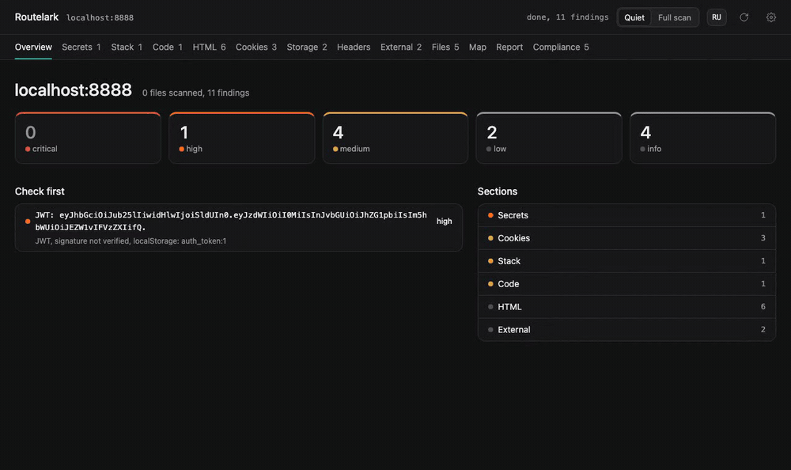
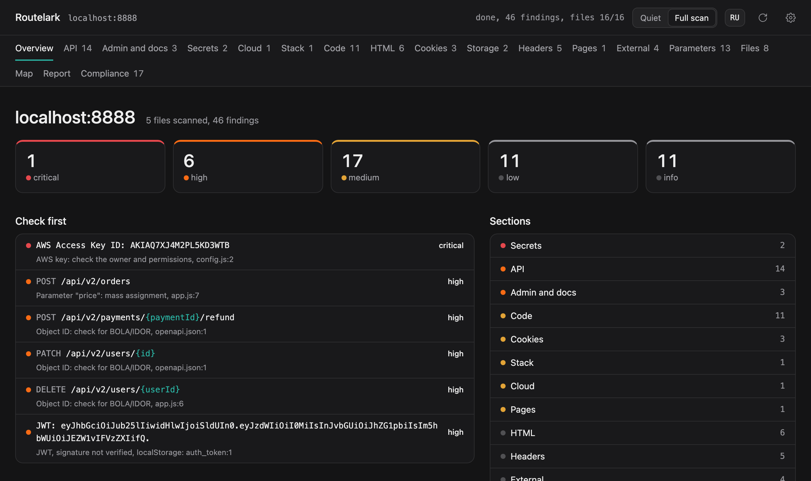
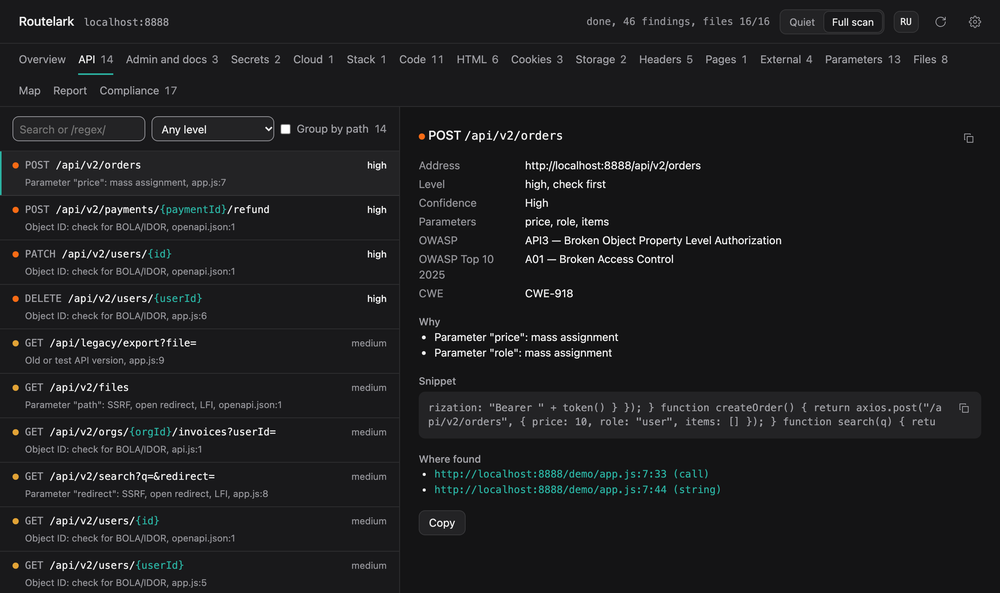
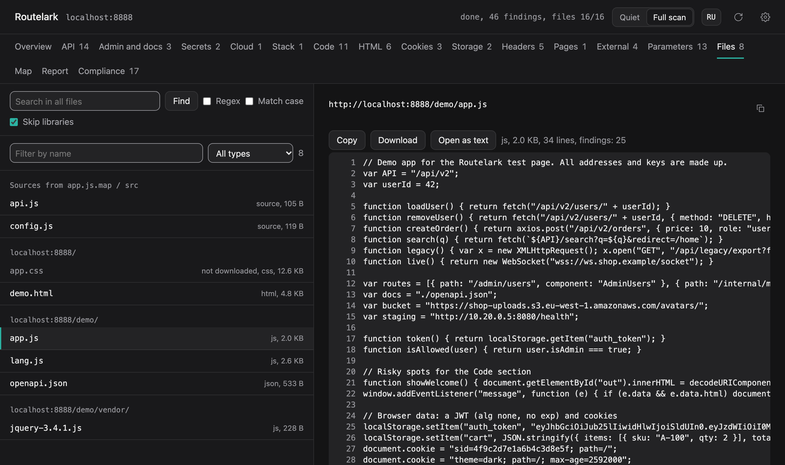
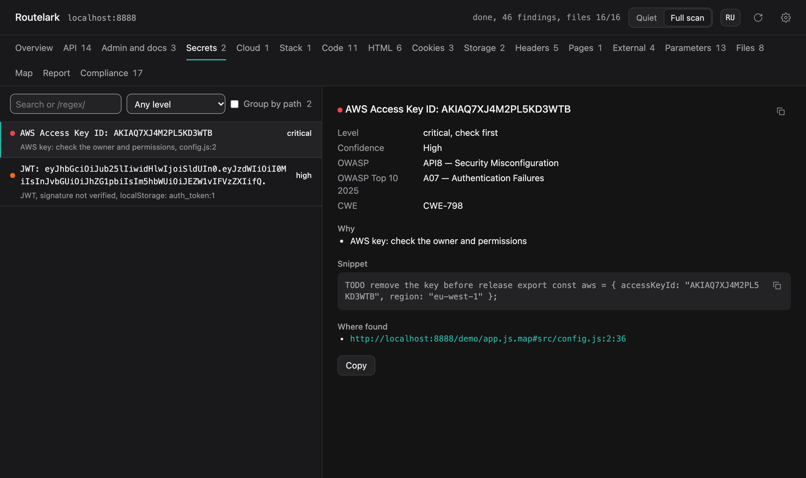
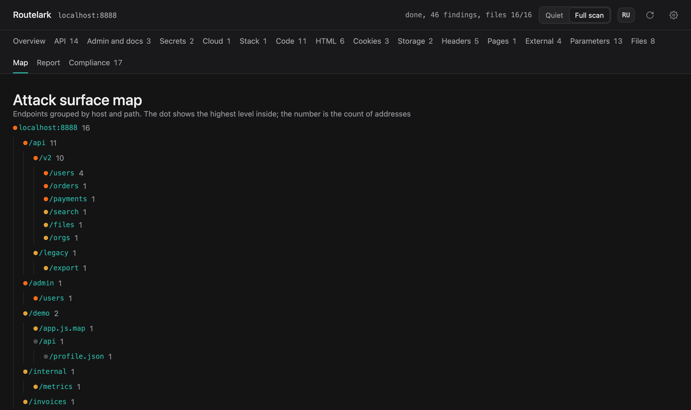
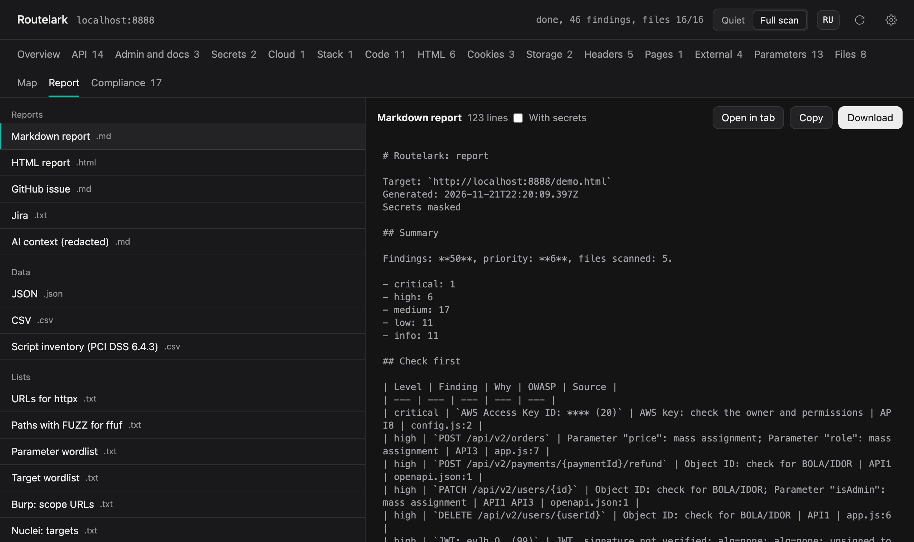

# Routelark

[Русский](README.ru.md)

**One bookmarklet that shows what a web page gives away: API endpoints, secrets, stack, headers, cookies, storage and risky client code, from its HTML, JavaScript, source maps and service files.**

[](LICENSE)




Click the bookmarklet on a page in your scope. A Routelark tab opens next to it and fills with findings while the scan runs. Everything is inside the bookmarklet: no server, no hosting, no install.

> [!IMPORTANT]
> Use Routelark only on systems you own or have written permission to test. Findings are leads for manual review, not confirmed vulnerabilities.

## Contents

- [Features](#features)
- [Screenshots](#screenshots)
- [Quick start](#quick-start)
- [How it works](#how-it-works)
- [What it does to the site](#what-it-does-to-the-site)
- [Privacy](#privacy)
- [Exports](#exports)
- [Browser support and limits](#browser-support-and-limits)
- [Chrome and Edge](#chrome-and-edge)
- [Safari](#safari)
- [Development](#development)
- [Contributing](#contributing)
- [License](#license)

## Features

| Area | What you get |
| --- | --- |
| **Endpoints** | Calls from `fetch`, axios (also `axios({url, method})` and `axios.create` instances), jQuery, XHR, Angular `HttpClient`, TypeScript generics, WebSocket, Socket.IO, SignalR; string paths, template literals and concatenation; methods and parameters; OpenAPI/Swagger files; Next.js pages and server actions; Nuxt and SvelteKit data routes; the Vite build manifest; Module Federation modules; tRPC procedures; GraphQL operations, fragments, variables and persisted ids with a schema draft |
| **Risk hints** | OWASP API Top 10 tags and OWASP Top 10 2025, CWE, ASVS 5.0 and WSTG v4.2 references on every finding: object IDs (BOLA/IDOR), admin and debug paths, SSRF and mass-assignment parameters, old API versions |
| **Secrets** | 60+ key formats (cloud, payment, AI providers, Hugging Face, Vercel, Cloudflare, Sentry, GitLab, Slack, Doppler, Pinecone and more); keys that are public by design (Stripe `pk_`, Supabase publishable, Sentry DSN, Firebase) are marked as such; Google keys near Gemini calls; JWT with `alg`, `jku`, `kid`, lifetime and Supabase role |
| **Personal data** | Card numbers (Luhn), IBAN, INN, SNILS, OGRN, US SSN, phones, e-mails, password hashes, with checksums and masking |
| **Cloud and identity** | Buckets and hosting, Firebase, Supabase, Cognito, Amplify, Auth0, Keycloak and Okta configs; AI in the frontend (browser SDK keys, LLM gateways, MCP endpoints, system prompts); OIDC discovery, `.well-known` files, mobile apps and deep links |
| **Supply chain** | Known malicious package versions from 2025–2026 incidents, compromised vendor script hosts, dead CDNs such as polyfill.io, look-alike CDN hosts, versions from pnpm paths and license banners, skimmer signals on payment pages |
| **Source maps** | Found by comment or `SourceMap` header; original sources are analysed too; scoped packages listed for dependency-confusion checks |
| **Stack** | Library versions from globals and banners, known advisories (2026 Next.js, Angular, Nuxt, DOMPurify), optional OSV.dev lookup, end-of-life notes |
| **Headers** | CSP quality, HSTS and preload readiness, framing, `nosniff`, Referrer-Policy, Permissions-Policy, COOP/COEP, Reporting, Server-Timing, Clear-Site-Data, CORS with credentials, debug headers, cache and CDN signals, version leaks |
| **Client code** | DOM sinks, weak `postMessage` origin checks, prototype pollution, client-side path traversal, Angular/Vue/React trust bypasses, Trusted Types pass-through, JSONP, open redirects, OAuth flows, token storage, feature flags, debug switches, client-side prices and limits, dev builds, build variables, obfuscation, Web3 signing code, WASM modules |
| **Files** | Every file the scan read and every original source from source maps, as a host and folder tree; a viewer with line numbers and formatting for minified JS and JSON; decoding of obfuscated strings and packed code without running it; search across all files with regex; jumps from a finding to its line; previews of pictures, audio, video and fonts; any text file the page loaded (JS, CSS, JSON, HTML, XML, YAML, CSV) opens with one click, also in Quiet mode; metadata of images, PDF, Office documents, fonts and WASM on request |
| **HTML** | Forms that post to other sites or over HTTP, hidden tokens, mixed content, external files without SRI, Speculation Rules, `target=_blank` without `noopener`, inline handlers, telling HTML comments, error pages and stack traces |
| **Privacy** | Trackers and session replay on pages with forms, tracker cookies and the consent state, personal data in URLs sent to third parties |
| **Cookies and storage** | Flags and prefix audit, tokens in Web Storage, service workers, Cache Storage and IndexedDB names, value decoding (URL, base64, JSON, JWT, time), an editor with import, export and undo |
| **Workflow** | Starts on click, compares each rescan with the previous one including changed JS files, program scope import (HackerOne, Bugcrowd or a host list), an attack surface map with authorization by host, a compliance view (ASVS V3, WSTG), pasted response headers when the tab cannot read them, same-origin iframes, `/regex/` search, import from Burp, ZAP, Caido, HAR and URL lists, a target wordlist, live page traffic, custom regex rules, session files, offline analysis of JS, maps and HAR |
| **Interface** | English and Russian, light and dark theme, works on sites with a strict CSP |

## Screenshots

| Overview | API finding |
| --- | --- |
| [](docs/screens/overview.png) | [](docs/screens/api.png) |
| **Files** | **Secrets** |
| [](docs/screens/files.png) | [](docs/screens/secrets.png) |
| **Map** | **Report** |
| [](docs/screens/map.png) | [](docs/screens/report.png) |

## Quick start

1. Download `routelark.html` from the [latest release](../../releases/latest). It is the only file you need.
2. Open the file in Chrome, Edge or Safari. A double-click is enough: it works straight from your disk.
3. Drag the **Routelark** button to your bookmarks bar.
4. Open a page you are allowed to test and click the bookmark. A Routelark tab opens with the results.
5. The first pass is **Quiet**: only what the page already loaded, no requests of its own. Switch to **Full scan** in the header to download JS, source maps and service files.

Need a target to try it on? [OWASP Juice Shop](https://owasp.org/www-project-juice-shop/) is a deliberately vulnerable shop made for practice.

## How it works

```
target page ── click ──▶ the bookmarklet (whole tool, ~690 KB)
                          ├─ reads the page: HTML, scripts, resource timing, storage, cookies, globals
                          ├─ in Full scan: downloads JS, source maps and service files by the rules below
                          └─ opens a blank tab next to the page and builds the Routelark interface in it
```

The bookmarklet carries the entire tool, so nothing is loaded from anywhere when you click it. The new tab is a blank page of the same site; the interface is drawn into it by the bookmarklet's code. All analysis happens in your browser. The only outside requests are the optional OSV.dev and npm lookups in Full scan, see [Privacy](#privacy).

## What it does to the site

Routelark is built to be harmless to the site it inspects:

- Every launch starts in **Quiet** mode: Routelark reads only what the page already loaded and sends no requests of its own. Pick **Full scan** in the header to download JS, source maps and service files as set in **Settings**. Each mode keeps its results while the tab is open: switching back shows them without a new scan, and **Rescan** runs the current mode again.
- `GET` only towards the scanned site, one request at a time, a pause of 500 ms by default, a budget of 400 requests, at most 25 MB and 5 minutes per scan.
- The page itself is fetched once more (one `GET`, HTML pages only) to read its response headers. Apart from that, only JS, source maps, `.LICENSE.txt` files named in a bundle, `robots.txt`, `sitemap*.xml`, `security.txt`, a few `.well-known` files (OIDC discovery, app links, WebAuthn), `ads.txt`, `humans.txt`, `llms.txt`, the web manifest, the Vite build manifest and OpenAPI files named in the code. The favicon and document metadata are read only when you press their buttons. **API endpoints are never called. Redirects are not followed.**
- The registrable domain of the page and its subdomains (for `shop.example.com` that is every `*.example.com`); other hosts only when you add them. Neighbouring subdomains on shared hosting (`github.io`, `vercel.app`, …) are out of scope.
- Paths with `logout`, `delete`, `remove`, `revoke` and similar are skipped.
- A host is dropped on HTTP 429 or a WAF challenge page.
- The page is left as it is: no patched `fetch`, no writes to its storage, no injected styles, no new caches (Cache Storage and IndexedDB are listed by name only). Cookies change only when you edit them.

The full list of rules is in [SECURITY.md](SECURITY.md).

## Privacy

- Page data goes from the page to the Routelark tab inside your browser. No server receives it.
- Settings and the comparison with the previous scan live only while the Routelark tab is open. Nothing is written to the site's storage. Use **Save session** to keep results.
- Two optional outside lookups: `package@version` to OSV.dev (a `POST` with the name and version, on by default in Full scan) and scoped package names to registry.npmjs.org (a `HEAD` request, off by default). Both can be turned off in **Settings**.
- Secrets are shown in full on screen and masked in exports unless you turn on **With secrets**.

## Exports

Every format has a preview in the tab, then **Download**, **Copy** or **Open in tab**. Secrets are masked unless you ask for them.

| Group | Formats |
| --- | --- |
| Reports | Markdown, HTML, GitHub issue, Jira |
| Platforms | Report drafts for bug bounty platforms, grouped by root cause, with a CVSS 4.0 vector for secrets |
| Data | JSON, CSV, script inventory for PCI DSS 6.4.3 |
| Lists | full URLs (httpx), paths with `FUZZ` (ffuf), sibling route guesses, parameter wordlist, target wordlist, Burp scope, Katana scope, Nuclei targets |
| Tools | OpenAPI 3 draft, Postman 2.1, HAR, SARIF 2.1.0, CycloneDX 1.5, GraphQL schema draft, Caido scope, ZAP context, DefectDojo, Faraday |
| Per finding | Bruno request, Nuclei template |

## Browser support and limits

Works in Chrome, Edge and other Chromium browsers, and in Safari. Tested in Chrome.

- **Firefox is not supported.** Firefox cuts bookmarks longer than 64 KB without a warning ([bug 604374](https://bugzilla.mozilla.org/show_bug.cgi?id=604374)), and the whole tool is larger.
- **Safari:** needs pop-ups allowed and, on sites with a strict CSP, the console. Step-by-step setup is in [Safari](#safari).
- **Settings:** language, theme and scan settings reset each time a Routelark tab opens. Language and theme follow your browser.
- **Big sites:** the analysis runs in the Routelark tab, which the browser keeps in the same process as the page, so a heavy page may respond slowly while a Full scan runs.
- **Cookies:** HttpOnly cookies are hidden from scripts by the browser. Safari limits cookies written from scripts to 7 days.
- **Traffic:** read without patching `fetch`, so it has address, time and status but no method or bodies.

## Chrome and Edge

1. **Show the bookmarks bar.** Chrome: **⌘⇧B** on macOS, **Ctrl+Shift+B** on Windows and Linux. Edge calls it the favorites bar and uses the same keys.
2. **Add the bookmarklet.** Open `routelark.html` and drag the **Routelark** button to the bar.
   If dragging does not work: right-click the button, choose **Copy link address**, then right-click the bar, choose **Add page…** (Edge: **Add favorite**), name it Routelark and paste the link as the URL.
3. **Run it.** Open a page you are allowed to test and click the bookmark. The Routelark tab opens next to it.
4. **If the tab does not open,** the pop-up blocker stopped it: click the blocked pop-up icon at the right of the address bar, choose **Always allow pop-ups from this site** and click the bookmark again.
5. **If clicking the bookmark does nothing,** use the console: in `routelark.html` click **Copy code for DevTools console**, open the target page, press **F12** (macOS: **⌥⌘J**), choose **Console**, paste and press Enter. Chrome may ask you to type `allow pasting` first.

## Safari

Safari needs a few settings before the bookmarklet works. Menu names are from Safari 17 and 18 on macOS.

1. **Show the Favorites bar.** **View → Show Favorites Bar** (⇧⌘B).
2. **Add the bookmarklet.** Open `routelark.html` and drag the **Routelark** button to the Favorites bar.
   If Safari will not drop it: right-click the button and choose **Copy Link**. Then bookmark any page (⌘D) into Favorites, open **Bookmarks → Edit Bookmarks**, right-click the new bookmark, choose **Edit Address** and paste the link. Name it Routelark.
3. **Allow pop-ups for the sites you test.** Routelark opens its results in a new tab, and Safari blocks new tabs by default.
   **Safari → Settings → Websites → Pop-up Windows**: set the target site to **Allow**. To allow every site, use **When visiting other websites: Allow**.
   If this is not done, the bookmarklet shows "the browser blocked the new tab".
   If the tab opens in the background, turn on **Safari → Settings → Tabs → When a new tab or window opens, make it active**.
4. **If clicking the bookmarklet does nothing**, turn on the developer features:
   - **Safari → Settings → Advanced → Show features for web developers**.
   - Then open **Settings → Developer** and turn on **Allow JavaScript from Smart Search Field**. Some Safari versions need this before they run bookmarks that start with `javascript:`.
5. **Sites with a strict CSP.** If the site's Content-Security-Policy forbids inline scripts, Safari blocks every bookmarklet on it. Use the console instead:
   1. In `routelark.html`, click **Copy code for DevTools console**.
   2. Open the target page and press **⌥⌘C** (**Develop → Show JavaScript Console**).
   3. Paste the code and press Return. The Routelark tab opens as usual.

   Paste it into the console, not into the address bar: Safari does not run code pasted into the address bar.
6. **A limit that stays:** Safari keeps cookies written from scripts for 7 days at most.

## Development

```bash
npm install
npm test             # node --test, no browser needed
npm run build        # dist/routelark.html and the bookmarklet size
npm run serve        # http://localhost:8888/ and the test page /demo.html
```

The test page and the local server are only for developing Routelark. To publish a release, push a tag such as `v1.0.0`: the `Release` workflow builds `routelark.html` and attaches it to a GitHub release.

| Path | What |
| --- | --- |
| `src/core.js`, `src/core/` | Analysis without DOM, covered by tests |
| `src/bookmarklet.js` | The bookmarklet entry: opens the tab and starts the interface in it |
| `src/collector.js` | Reads the page and downloads files by the safety rules |
| `src/app/` | The interface |
| `src/i18n.js` | English strings and the Russian dictionary |
| `site/` | The `routelark.html` shell, styles and the test page |
| `test/` | Tests and the local server |

Test stands on the local server: `/csp/demo.html` (strict CSP), `/coop/demo.html` (COOP), `/limit.js` (always 429).

To see a scan the way the site sees it, open `http://localhost:8888/__log`: every request with its method, status, type (browser load or fetch from code), Origin and Referer, the names of the cookies it carried, IP and User-Agent. Press **Mark** before you click the bookmarklet: the marked row and everything above it (new requests appear on top) is the scan.

## Contributing

Bug reports, missed or false findings and pull requests are welcome. See [CONTRIBUTING.md](CONTRIBUTING.md). Security problems in Routelark itself: see [SECURITY.md](SECURITY.md).

## License

[MIT](LICENSE).
