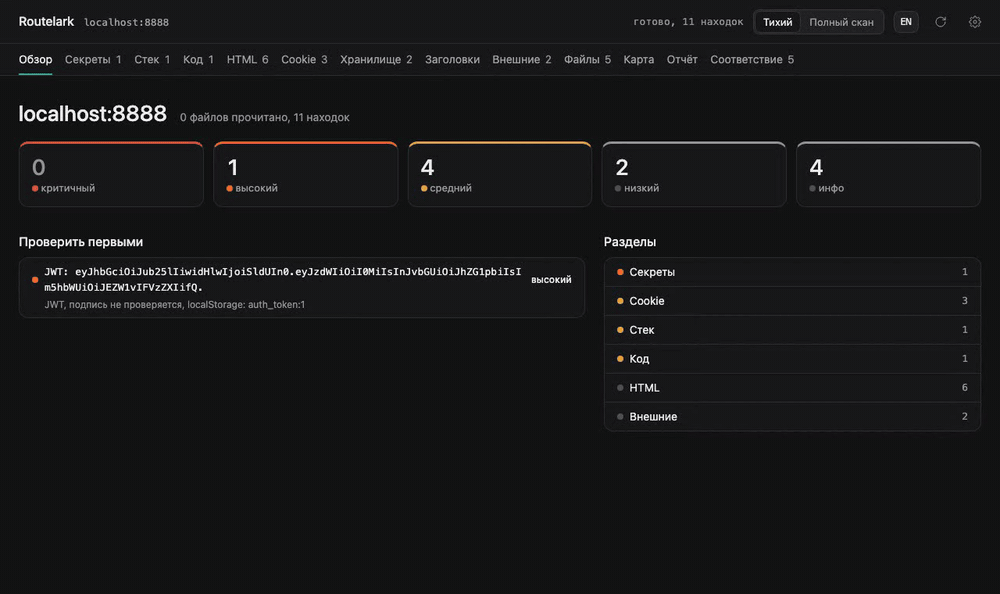
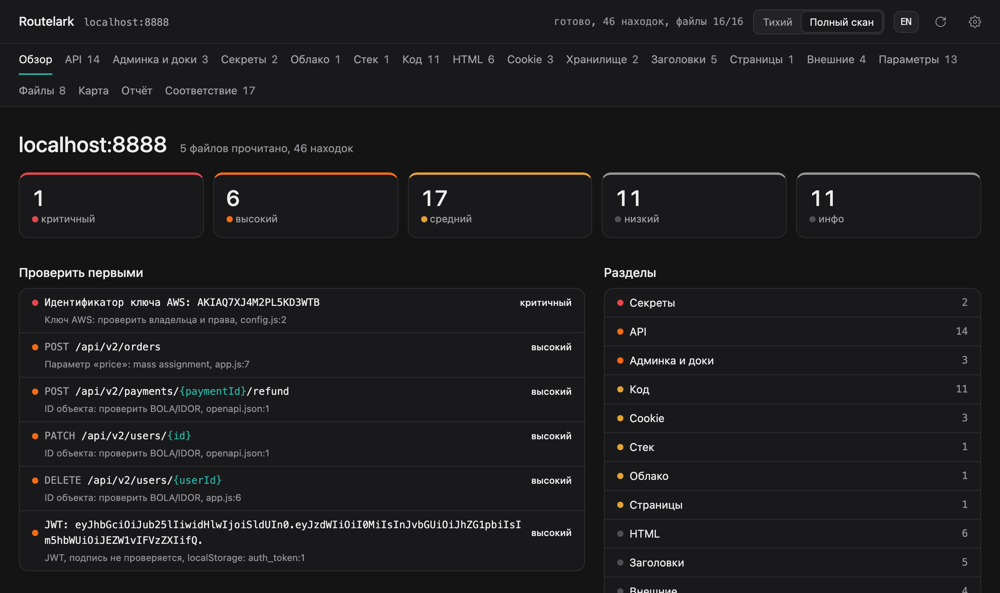
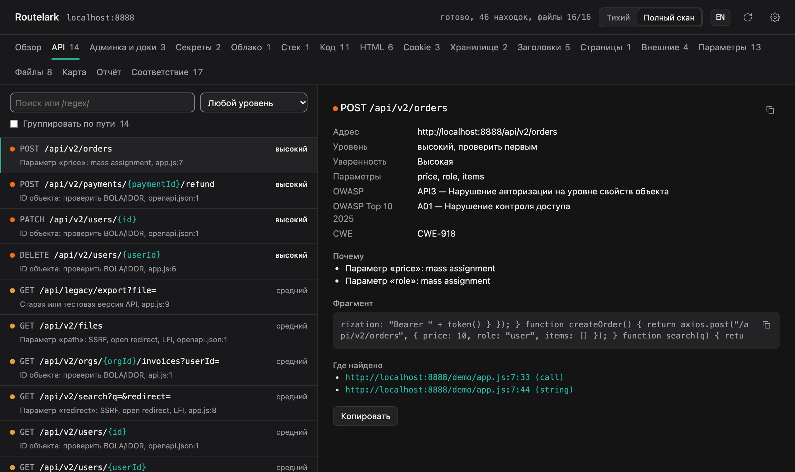
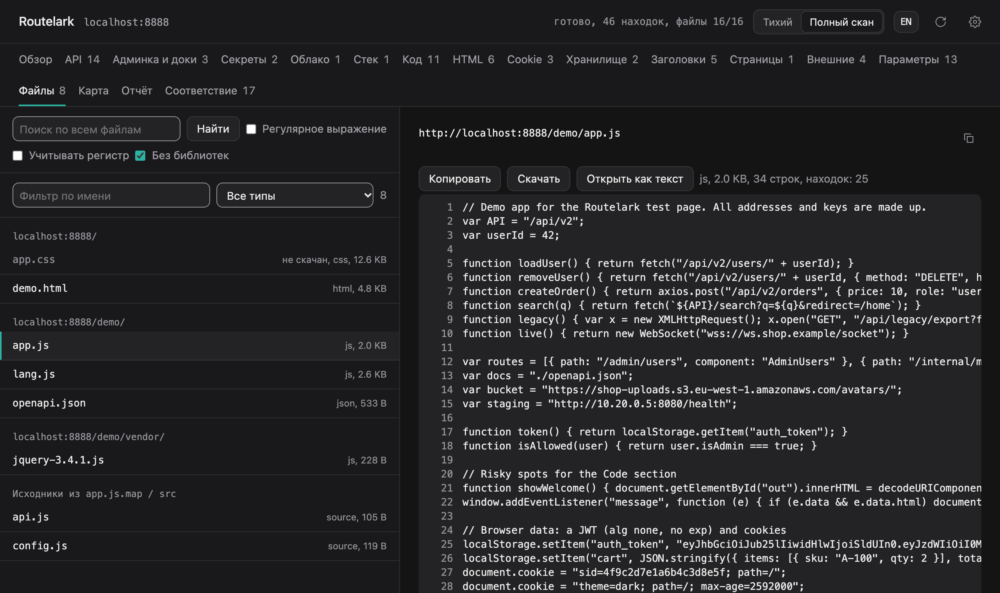
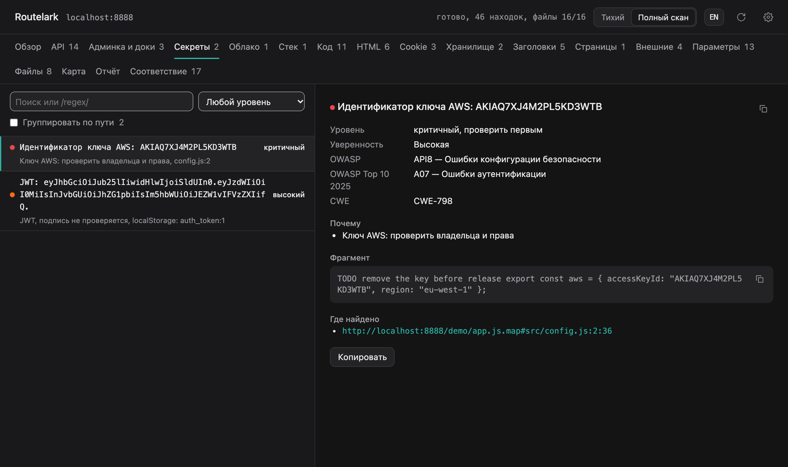
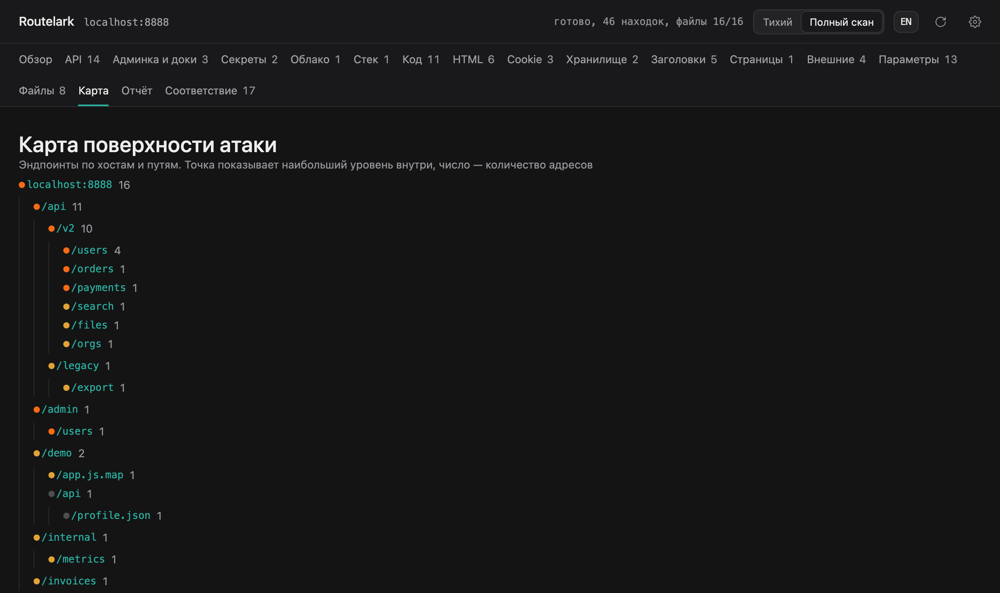
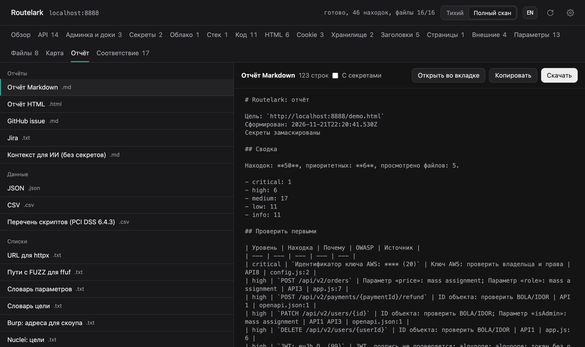

# Routelark

[English](README.md)

**Одна закладка показывает, что веб-страница отдаёт сама: адреса API, секреты, стек, заголовки, cookies, хранилище и опасные места в клиентском коде — из её HTML, JavaScript, source map и служебных файлов.**

[](LICENSE)




Нажмите закладку на странице из своего скоупа. Рядом откроется вкладка Routelark и заполнится находками по ходу скана. Весь инструмент внутри закладки: без сервера, хостинга и установки.

> [!IMPORTANT]
> Используйте Routelark только на своих системах или с письменного разрешения. Находки - повод для ручной проверки, а не подтверждённые уязвимости.

## Содержание

- [Возможности](#возможности)
- [Скриншоты](#скриншоты)
- [Быстрый старт](#быстрый-старт)
- [Как это работает](#как-это-работает)
- [Что Routelark делает с сайтом](#что-routelark-делает-с-сайтом)
- [Конфиденциальность](#конфиденциальность)
- [Экспорт](#экспорт)
- [Браузеры и ограничения](#браузеры-и-ограничения)
- [Chrome и Edge](#chrome-и-edge)
- [Safari](#safari)
- [Разработка](#разработка)
- [Участие](#участие)
- [Лицензия](#лицензия)

## Возможности

| Раздел | Что вы получаете |
| --- | --- |
| **Эндпоинты** | Вызовы `fetch`, axios (в том числе `axios({url, method})` и экземпляры `axios.create`), jQuery, XHR, Angular `HttpClient`, дженерики TypeScript, WebSocket, Socket.IO, SignalR; пути в строках, шаблонных строках и склейках; методы и параметры; файлы OpenAPI/Swagger; страницы и server actions Next.js; маршруты данных Nuxt и SvelteKit; манифест сборки Vite; модули Module Federation; процедуры tRPC; операции, фрагменты, переменные и persisted-идентификаторы GraphQL с черновиком схемы |
| **Подсказки по риску** | Метки OWASP API Top 10 и OWASP Top 10 2025, CWE, ссылки на ASVS 5.0 и WSTG v4.2 у каждой находки: ID объектов (BOLA/IDOR), админские и отладочные пути, параметры для SSRF и mass assignment, старые версии API |
| **Секреты** | Больше 60 форматов ключей (облака, платежи, ИИ-провайдеры, Hugging Face, Vercel, Cloudflare, Sentry, GitLab, Slack, Doppler, Pinecone и другие); публичные по замыслу ключи (Stripe `pk_`, publishable Supabase, Sentry DSN, Firebase) помечаются; ключи Google рядом с вызовами Gemini; JWT с `alg`, `jku`, `kid`, сроком жизни и ролью Supabase |
| **Персональные данные** | Номера карт (Luhn), IBAN, ИНН, СНИЛС, ОГРН, SSN, телефоны, почта, хеши паролей — с контрольными суммами и маскированием |
| **Облака и учётные записи** | Бакеты и хостинги, конфиги Firebase, Supabase, Cognito, Amplify, Auth0, Keycloak и Okta; ИИ во фронтенде (ключи SDK в браузере, LLM-шлюзы, MCP-эндпоинты, системные промпты); OIDC discovery, файлы `.well-known`, мобильные приложения и deep link |
| **Цепочка поставок** | Известные вредоносные версии пакетов из инцидентов 2025–2026 годов, взломанные хосты скриптов поставщиков, мёртвые CDN вроде polyfill.io, домены, похожие на CDN, версии из путей pnpm и баннеров лицензий, признаки скиммеров на платёжных страницах |
| **Source maps** | Находятся по комментарию или заголовку `SourceMap`; исходные файлы тоже анализируются; пакеты со scope выписываются для проверки на подмену зависимостей |
| **Стек** | Версии библиотек по глобальным объектам и баннерам, известные уязвимости (в том числе Next.js, Angular, Nuxt, DOMPurify 2026 года), необязательная проверка в OSV.dev, отметки о конце поддержки |
| **Заголовки** | Качество CSP, HSTS и готовность к preload, защита от фрейминга, `nosniff`, Referrer-Policy, Permissions-Policy, COOP/COEP, отчёты, Server-Timing, Clear-Site-Data, CORS с credentials, отладочные заголовки, признаки кеша и CDN, утечка версий |
| **Клиентский код** | DOM-sinks, слабые проверки origin в `postMessage`, загрязнение прототипа, client-side path traversal, обходы доверия Angular/Vue/React, сквозные политики Trusted Types, JSONP, открытые перенаправления, потоки OAuth, хранение токенов, флаги функций, отладочные переключатели, цены и лимиты на клиенте, dev-сборки, переменные сборки, обфускация, код подписи Web3, модули WASM |
| **Файлы** | Все прочитанные сканом файлы и исходники из source map деревом «хост → папка»; просмотр с номерами строк и форматированием минифицированного JS и JSON; расшифровка обфусцированных строк и packed-кода без выполнения; поиск по всем файлам с regex; переход от находки к её строке; просмотр картинок, аудио, видео и шрифтов; любой текстовый файл, загруженный страницей (JS, CSS, JSON, HTML, XML, YAML, CSV), открывается одним нажатием, в том числе в тихом режиме; метаданные картинок, PDF, документов Office, шрифтов и WASM по кнопке |
| **HTML** | Формы, отправляющие данные на другой сайт или по HTTP, скрытые токены, смешанный контент, внешние файлы без SRI, Speculation Rules, `target=_blank` без `noopener`, обработчики в атрибутах, говорящие HTML-комментарии, страницы ошибок и stack trace |
| **Приватность** | Трекеры и запись сессий на страницах с формами, cookies трекеров и состояние согласия, персональные данные в адресах к третьим сторонам |
| **Cookies и storage** | Проверка флагов и префиксов, токены в Web Storage, service worker, имена Cache Storage и баз IndexedDB, расшифровка значений (URL, base64, JSON, JWT, время), редактор с импортом, экспортом и отменой |
| **Работа** | Скан по нажатию, сравнение каждого повторного скана с предыдущим, включая изменённые JS-файлы, импорт скоупа программы (HackerOne, Bugcrowd или список хостов), карта поверхности атаки с авторизацией по хостам, вкладка соответствия (ASVS V3, WSTG), вставка заголовков ответа, если вкладка не смогла их прочитать, фреймы своего origin, поиск `/regex/`, импорт из Burp, ZAP, Caido, HAR и списков адресов, словарь цели, живой трафик страницы, свои правила на регулярках, файлы сессии, офлайн-разбор JS, map и HAR |
| **Интерфейс** | Английский и русский, светлая и тёмная тема, работает на сайтах со строгой CSP |

## Скриншоты

| Обзор | Находка в API |
| --- | --- |
| [](docs/screens/ru/overview.png) | [](docs/screens/ru/api.png) |
| **Файлы** | **Секреты** |
| [](docs/screens/ru/files.png) | [](docs/screens/ru/secrets.png) |
| **Карта** | **Отчёт** |
| [](docs/screens/ru/map.png) | [](docs/screens/ru/report.png) |

## Быстрый старт

1. Скачайте `routelark.html` из [последнего релиза](../../releases/latest). Это единственный нужный файл.
2. Откройте файл в Chrome, Edge или Safari. Достаточно двойного клика: он работает прямо с диска.
3. Перетащите кнопку **Routelark** на панель закладок.
4. Откройте страницу, которую вам разрешено проверять, и нажмите закладку. Откроется вкладка Routelark с результатами.
5. Первый проход — **тихий**: только то, что страница уже загрузила, без своих запросов. Чтобы скачать JS, source map и служебные файлы, выберите в шапке **Полный скан**.

Нужна цель для пробы? [OWASP Juice Shop](https://owasp.org/www-project-juice-shop/) — специально уязвимый магазин для тренировки.

## Как это работает

```
страница сайта ── нажатие ──▶ закладка (весь инструмент, ~690 КБ)
                               ├─ читает страницу: HTML, скрипты, тайминги загрузки, storage, cookies, глобальные объекты
                               ├─ в полном скане: скачивает JS, source map и служебные файлы по правилам ниже
                               └─ открывает рядом пустую вкладку и строит в ней интерфейс Routelark
```

Закладка несёт в себе весь инструмент, поэтому при нажатии ничего ниоткуда не загружается. Новая вкладка — пустая страница того же сайта, интерфейс в неё рисует код закладки. Весь анализ идёт в вашем браузере. Наружу уходят только необязательные запросы к OSV.dev и npm в полном скане, см. [Конфиденциальность](#конфиденциальность).

## Что Routelark делает с сайтом

Routelark сделан так, чтобы не вредить сайту, который он смотрит:

- Каждый запуск начинается в **тихом** режиме: Routelark читает только то, что страница уже загрузила, и не делает своих запросов. Чтобы скачать JS, source map и служебные файлы по **Настройкам**, выберите в шапке **Полный скан**. Результаты каждого режима сохраняются, пока открыта вкладка: при возврате они показываются без нового скана, а **Сканировать заново** запускает текущий режим заново.
- К проверяемому сайту — только `GET`, по одному запросу, пауза 500 мс по умолчанию, бюджет 400 запросов, не больше 25 МБ и 5 минут на скан.
- Сама страница запрашивается ещё раз (один `GET`, только HTML), чтобы прочитать заголовки ответа. Кроме неё — только JS, source maps, файлы `.LICENSE.txt`, упомянутые в бандле, `robots.txt`, `sitemap*.xml`, `security.txt`, несколько файлов `.well-known` (OIDC discovery, ссылки приложений, WebAuthn), `ads.txt`, `humans.txt`, `llms.txt`, web manifest, манифест сборки Vite и файлы OpenAPI, упомянутые в коде. Favicon и метаданные документов читаются только по кнопке. **Адреса API не вызываются никогда. По редиректам не ходит.**
- Регистрируемый домен страницы и его поддомены (для `shop.example.com` это все `*.example.com`); другие хосты — только добавленные вами. Соседние поддомены на общих хостингах (`github.io`, `vercel.app` и подобных) вне скоупа.
- Пропускает пути с `logout`, `delete`, `remove`, `revoke` и подобными.
- Останавливает скан хоста на ответе 429 и на странице проверки WAF.
- Страницу не меняет: не подменяет `fetch`, не пишет в её storage, не добавляет стили, не создаёт кешей (Cache Storage и IndexedDB только перечисляются по именам). Cookies меняются только вашими правками.

Полный список правил — в [SECURITY.md](SECURITY.md).

## Конфиденциальность

- Данные страницы идут во вкладку Routelark внутри вашего браузера. Ни один сервер их не получает.
- Настройки и сравнение с прошлым сканом живут, только пока открыта вкладка Routelark. В хранилище сайта ничего не пишется. Чтобы сохранить результаты, используйте **Сохранить сессию**.
- Два необязательных внешних запроса: `пакет@версия` в OSV.dev (запрос `POST` с именем и версией, включён по умолчанию в полном скане) и имена пакетов со scope на registry.npmjs.org (запрос `HEAD`, выключен по умолчанию). Оба отключаются в **Настройках**.
- На экране секреты видны целиком, в экспорте замаскированы, пока вы не включите **С секретами**.

## Экспорт

У каждого формата есть просмотр во вкладке, затем **Скачать**, **Копировать** или **Открыть во вкладке**. Секреты замаскированы, если вы не попросите иначе.

| Группа | Форматы |
| --- | --- |
| Отчёты | Markdown, HTML, GitHub issue, Jira |
| Платформы | Черновики отчётов для BugBounty платформ, сгруппированные по причине, с вектором CVSS 4.0 для секретов |
| Данные | JSON, CSV, перечень скриптов для PCI DSS 6.4.3 |
| Списки | полные URL (httpx), пути с `FUZZ` (ffuf), догадки о соседних маршрутах, словарь параметров, словарь цели, скоуп Burp, скоуп Katana, цели Nuclei |
| Инструменты | черновик OpenAPI 3, Postman 2.1, HAR, SARIF 2.1.0, CycloneDX 1.5, черновик схемы GraphQL, скоуп Caido, контекст ZAP, DefectDojo, Faraday |
| Для находки | запрос Bruno, шаблон Nuclei |

## Браузеры и ограничения

Работает в Chrome, Edge и других браузерах на Chromium, а также в Safari. Проверено в Chrome.

- **Firefox не поддерживается.** Он без предупреждения обрезает закладки длиннее 64 КБ ([баг 604374](https://bugzilla.mozilla.org/show_bug.cgi?id=604374)), а весь инструмент больше.
- **Safari:** нужно разрешить всплывающие окна, а на сайтах со строгой CSP — пользоваться консолью. Пошаговая настройка — в разделе [Safari](#safari).
- **Настройки:** язык, тема и параметры скана сбрасываются при каждом открытии вкладки Routelark. Системные язык и тема берутся из браузера.
- **Большие сайты:** анализ идёт во вкладке Routelark, а браузер держит её в одном процессе со страницей, поэтому тяжёлая страница может отвечать медленнее, пока идёт полный скан.
- **Cookies:** HttpOnly-cookies браузер скрывает от скриптов. Safari ограничивает cookies, записанные из скриптов, сроком 7 дней.
- **Трафик:** читается без подмены `fetch`, поэтому в нём есть адрес, время и статус, но нет метода и тел запросов.

## Chrome и Edge

1. **Включите панель закладок.** Chrome: **⌘⇧B** на macOS, **Ctrl+Shift+B** на Windows и Linux. В Edge она называется панелью избранного, сочетание то же.
2. **Добавьте закладку.** Откройте `routelark.html` и перетащите кнопку **Routelark** на панель.
   Если перетаскивание не работает: правый клик по кнопке → **Копировать адрес ссылки**, затем правый клик по панели → **Добавить страницу…** (в Edge — **Добавить в избранное**), назовите её Routelark и вставьте ссылку в поле адреса.
3. **Запустите.** Откройте страницу, которую вам разрешено проверять, и нажмите закладку. Рядом откроется вкладка Routelark.
4. **Если вкладка не открылась,** её остановила блокировка всплывающих окон: нажмите значок заблокированного окна справа в адресной строке, выберите **Всегда разрешать всплывающие окна на этом сайте** и нажмите закладку ещё раз.
5. **Если по нажатию ничего не происходит,** используйте консоль: в `routelark.html` нажмите **Скопировать код для консоли DevTools**, откройте целевую страницу, нажмите **F12** (macOS: **⌥⌘J**), выберите **Console**, вставьте код и нажмите Enter. Chrome может сначала попросить ввести `allow pasting`.

## Safari

В Safari закладка заработает после нескольких настроек. Названия пунктов меню взяты из Safari 17 и 18 на macOS.

1. **Включите панель «Избранное».** **Вид → Показать панель «Избранное»** (⇧⌘B).
2. **Добавьте закладку.** Откройте `routelark.html` и перетащите кнопку **Routelark** на панель «Избранное».
   Если Safari не даёт её бросить: нажмите на кнопку правой кнопкой и выберите **Скопировать ссылку**. Затем добавьте в «Избранное» любую страницу (⌘D), откройте **Закладки → Изменить закладки**, нажмите на новую закладку правой кнопкой, выберите **Изменить адрес** и вставьте ссылку. Назовите закладку Routelark.
3. **Разрешите всплывающие окна для проверяемых сайтов.** Routelark открывает результаты в новой вкладке, а Safari по умолчанию такие вкладки блокирует.
   **Safari → Настройки → Веб-сайты → Всплывающие окна**: для нужного сайта выберите **Разрешить**. Чтобы разрешить для всех сайтов, выберите **При посещении других веб-сайтов: Разрешить**.
   Если этого не сделать, закладка покажет сообщение «браузер заблокировал новую вкладку» (в английском браузере — «the browser blocked the new tab»).
   Если вкладка открывается в фоне, включите **Safari → Настройки → Вкладки → Делать новую вкладку или окно активными**.
4. **Если по нажатию на закладку ничего не происходит**, включите функции для разработчиков:
   - **Safari → Настройки → Дополнения → Показывать функции для веб-разработчиков**.
   - Затем на вкладке **Настройки → Разработчик** включите **Разрешить JavaScript из поля смарт-поиска**. В некоторых версиях Safari без этого закладки, которые начинаются с `javascript:`, не запускаются.
5. **Сайты со строгой CSP.** Если Content-Security-Policy сайта запрещает inline-скрипты, Safari блокирует на нём любые закладки. В этом случае используйте консоль:
   1. В `routelark.html` нажмите **Скопировать код для консоли DevTools**.
   2. Откройте целевую страницу и нажмите **⌥⌘C** (**Разработка → Показать консоль JavaScript**).
   3. Вставьте код и нажмите Return. Вкладка Routelark откроется как обычно.

   Вставлять нужно в консоль, а не в адресную строку: код, вставленный в адресную строку, Safari не выполняет.
6. **Что остаётся ограничением:** cookies, записанные из скриптов, Safari хранит не больше 7 дней.

## Разработка

```bash
npm install
npm test             # node --test, браузер не нужен
npm run build        # dist/routelark.html и размер закладки
npm run serve        # http://localhost:8888/ и тестовая страница /demo.html
```

Тестовая страница и локальный сервер нужны только для разработки Routelark. Чтобы выпустить релиз, отправьте тег вида `v1.0.0`: workflow `Release` соберёт `routelark.html` и приложит его к релизу на GitHub.

| Путь | Что там |
| --- | --- |
| `src/core.js`, `src/core/` | Анализ без DOM, покрыт тестами |
| `src/bookmarklet.js` | Вход закладки: открывает вкладку и запускает в ней интерфейс |
| `src/collector.js` | Читает страницу и скачивает файлы по правилам безопасности |
| `src/app/` | Интерфейс |
| `src/i18n.js` | Английские строки и русский словарь |
| `site/` | Оболочка `routelark.html`, стили, тестовая страница |
| `test/` | Тесты и локальный сервер |

Тестовые стенды на локальном сервере: `/csp/demo.html` (строгая CSP), `/coop/demo.html` (COOP), `/limit.js` (всегда 429).

Чтобы увидеть скан глазами сайта, откройте `http://localhost:8888/__log`: каждый запрос с методом, статусом, типом (загрузка браузером или fetch из кода), Origin и Referer, именами отправленных cookies, IP и User-Agent. Нажмите **Mark** перед нажатием закладки: отмеченная строка и всё над ней (новые запросы появляются сверху) — это скан.

## Участие

Сообщения об ошибках, пропущенных или ложных находках и pull request приветствуются. См. [CONTRIBUTING.md](CONTRIBUTING.md). О проблемах безопасности в самом Routelark — см. [SECURITY.md](SECURITY.md).

## Лицензия

[MIT](LICENSE).
